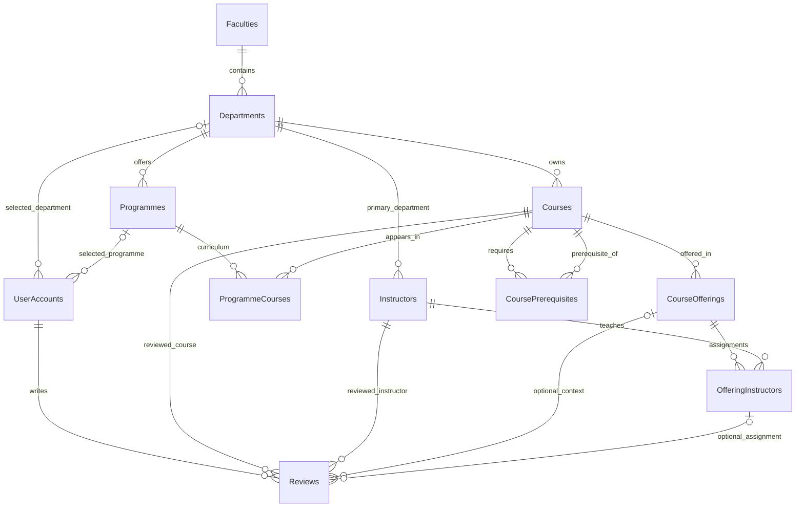

# Güncel modelin ilişki özeti

Kaynak: feature/democontrol @ 5b79729, ApplicationDbContextModelSnapshot. Bu çizim güncel kodun veri ilişkilerini belgeler; yeni mimari önerisi veya uygulanmış veritabanı şeması iddiası değildir. İlk PDF planlama çizimindeki eksik Programme/ProgrammeCourse katmanı ve isteğe bağlı yorum açılışı burada görünür.

OfferingId doluysa Review için bileşik FK'ler (OfferingId,CourseId) ve (OfferingId,InstructorId) de geçerlidir. Mermaid çizimi bu bileşik alan eşitliğini tek başına göstermez; ayrıntı model/sözlüktedir. ProgrammeCourses ve OfferingInstructors farklı ilişkilerdir. Resmî program kadro üyelikleri ayrı kanıt listesidir; dönemlik OfferingInstructors satırı diye sunulmaz. İsim benzerliği nedeniyle fakülte/derece/dil ilişkileri birleştirilmez.
